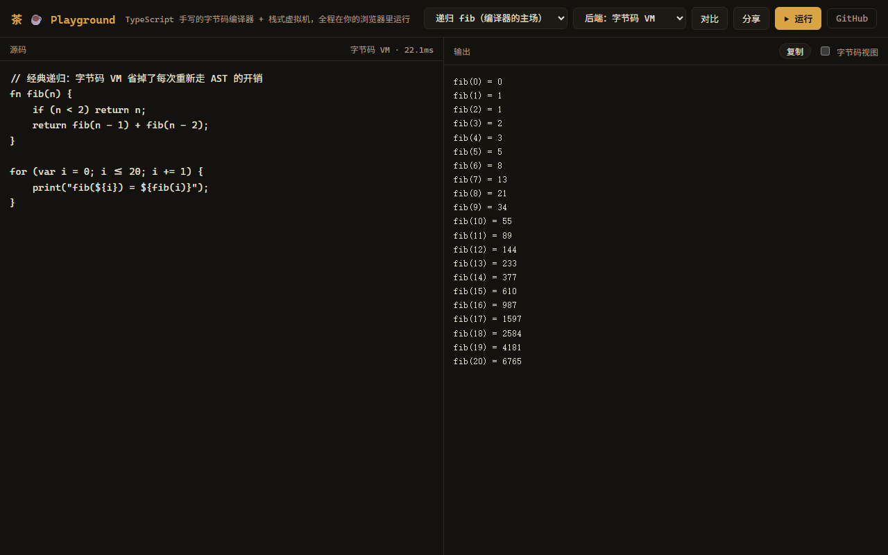
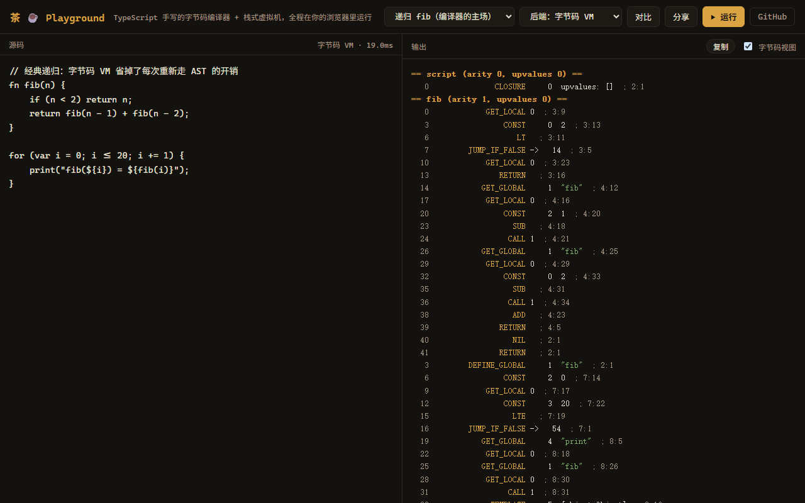
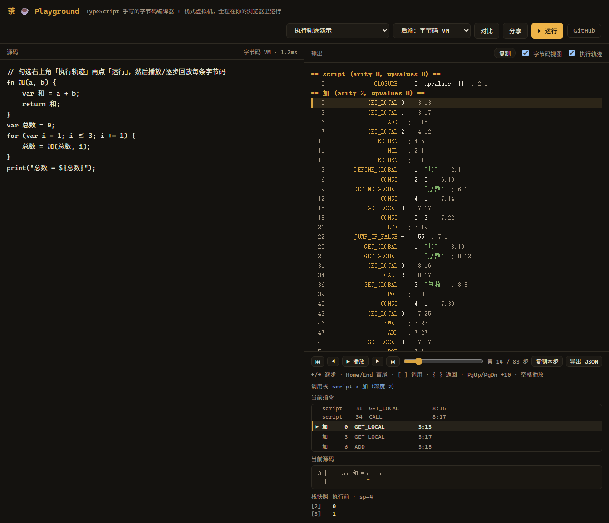

# Cha（茶）☕

[](https://github.com/huqinyuan923-hue/cha-lang/actions/workflows/ci.yml)

> 用 **TypeScript 从零手写**的微型编程语言：手写词法分析器 → 递归下降解析器 → 静态作用域解析，
> 两个可互换的执行后端——树遍历求值器与字节码编译器 + 栈式虚拟机。
> 零运行时依赖，`src/index.ts` 是纯模块（不依赖 Node API），可以直接编译进浏览器 Playground。

**在线体验**：<https://cha.adcakeyuan.top> —— 浏览器内编辑运行、双后端一键切换、可查看编译出的字节码，
还能采集并回放字节码执行轨迹（当前指令、调用栈与栈顶快照，最长 5000 步）。

<p align="center">
  
  
</p>

```cha
// 一杯茶的时间，看懂这门语言
var 杯子 = ["龙井", "普洱", "铁观音"];
fn 冲泡(茶名, 次数) {
    return "第 ${次数} 泡 ${茶名}";
}
for (var i = 1; i <= len(杯子); i += 1) {
    print(冲泡(杯子[i - 1], i));
}
```

## 快速开始

```bash
pnpm install

pnpm repl                # 交互式 REPL（表达式回显、多行输入、状态共享、历史跨会话保存）
pnpm cha run examples/hello.cha   # 运行脚本
pnpm cha check examples/*.cha     # 只做词法/语法/作用域/编译检查，不执行
pnpm test                # 单元 + 差分 + 300 种子模糊测试
pnpm build               # esbuild 打包成单文件 dist/cha.cjs
```

`cha check` 可以一次传多个文件，适合编辑器保存时或 CI 里当前置检查：全部通过返回 0，
有语法/作用域/编译错误返回 65（错误同样带源码行与插入符），读不到文件返回 66。
CLI 读取源码时会剥掉 Windows 编辑器常带的 UTF-8 BOM。

## 语言一览

```cha
// 变量（中文变量名是一等公民）
var 名字 = "茶";
var 版本 = 1;

// 控制流
if (版本 >= 1 and 名字 == "茶") {
    print("上茶！");
} else {
    print("茶还没好");
}

// 循环：while 和 for（for 是 while 的语法糖）
while (版本 < 3) {
    版本 += 1;
}
for (var i = 0; i < 3; i += 1) {
    print(i);
}

// 函数与闭包：函数是一等公民，闭包记得出生地
fn makeCounter() {
    var count = 0;
    fn inc() {
        count += 1;
        return count;
    }
    return inc;
}
var 计数 = makeCounter();
计数();  // 1
计数();  // 2

// 数组与 map（键支持字符串/标识符/数字/[计算]）
var 茶单 = {龙井: 30, 普洱: 25};
茶单["铁观音"] = 28;
print(茶单["龙井"], len(茶单), has(茶单, "普洱"));  // 30 3 true

// 类：init 构造，字段挂在实例上，方法共享，this 指实例
class 茶 {
    init(名字, 年份) {
        this.名字 = 名字;
        this.年份 = 年份;
    }
    介绍() { return "${this.名字}，${this.年份} 年"; }
}
class 普洱 < 茶 {
    介绍() { return super.介绍() + "，越陈越香"; }
}
var 熟普 = 普洱("熟普", 2000);
print(熟普.介绍());   // 熟普，2000 年，越陈越香

// 错误处理：throw 扔的是一个值，catch 接住的也是那个值
fn 点单(数量) {
    if (数量 <= 0) throw {"错误码": "数量不对", "收到": 数量};
    return 数量 * 8;
}
try {
    print(点单(0));
} catch (原因) {
    print("点单失败：", 原因["错误码"]);   // 点单失败： 数量不对
}
```

### 语法要点

| 主题 | 规则 |
| --- | --- |
| 语句结尾 | 每条语句以 `;` 结尾（暂时不做自动分号插入，这是特性不是缺陷） |
| 真值 | 只有 `false` 和 `nil` 为假，**`0` 和 `""` 都为真**（Lox 风格） |
| 加法 `+` | 只能数字+数字 或 字符串+字符串；混排请用 `"${...}"` 插值 |
| 相等 | `==` 对数组/map 做**深比较** |
| and/or | 短路求值，返回决定结果的那个操作数（Python 风格） |
| 注释 | `//` 行注释；`/* */` 块注释，**支持嵌套** |
| 字符串 | 双引号，支持 `\n` `\t` `\$` 转义；`${表达式}` 插值可任意嵌套 |
| 打印嵌套值 | 数组/map 里的字符串**不带引号**（`print([1, "a"])` → `[1, a]`），只有 map 的键带引号；`str()` 也只给顶层字符串加引号，看类型请用 `type()` |
| 标识符 | ASCII + **中文**（`var 变量 = 1` 合法） |
| 类 | `class 名 [< 父类] { 方法() { } }`；`init` 构造，字段用 `this.x = v` 自由生长，方法从类共享 |
| `{}` 歧义 | 语句开头的 `{` 是代码块；表达式位置的 `{}` 是 map（与 JS 相同） |
| 错误处理 | `throw 值;` 扔的是**任意值**（不是异常对象），`try { } catch (e) { }` 接住的就是原样那个值；运行时自己冒的错也能接住，接到的是那句中文消息 |

### 错误处理

`throw` 后面跟什么都是合法值：`throw "没茶了";`、`throw {"码": 500};`、`throw 列表;`，`catch (e)` 里的 `e`
不带包装，就是那个值本身。`try` 体一路跑完时 catch 体一眼都不看——VM 靠 `END_TRY` + `JUMP` 跳过，树遍历器
直接 return，两边形状一致。

运行时错误走同一个入口：下标越界、除零、`+` 混排类型、内建函数的参数检查，catch 到的是那句**中文错误消息
字符串**（前面的 `[line x, col y]` 会剥掉，行列在抛出的那一刻就定了）。没人接的 `throw` 才归位成
`ThrowError`，消息写作 `throw 抛出的值未被捕获：…`，位置取 `throw` 那一行；语法错误、未定义变量这类静态
错误在程序跑起来之前就断了，压根到不了 try。

CLI 与 Playground 还会把出错的那一行抄在错误下面，插入符按**显示宽度**定位——中文算两格、组合符零格、
tab 展开成 4 格、emoji 代理对整体算一个字符，超长行围绕插入符裁剪：

```text
运行时错误（第 3 行，第 12 列）：未定义的变量 '未知变量'
 3 | print(结果 + 未知变量);
   |              ^
```

片段由 `src/diagnostic.ts` 统一渲染，两个后端、CLI 与 Playground 共用同一份输出。REPL 刻意不显示片段：
会话里错误的行号可能属于上一段输入，拿当前这段源码去抄只会指错地方；错误标题仍会给出当前输入内的行列。
REPL 的历史存在 `~/.cha_repl_history`（最多 1000 条，可用 `CHA_HISTORY` 换路径），下次启动继续用上下键翻。

`return` / `break` / `continue` 可以穿过 `try`，处理器跟着帧一起退，不会留下悬垂的 catch 让后面的错误被
意外接住。**一个刻意的例外**：循环轮数预算是宿主级的止损，接住超预算的错误之后不会重新充能——同一次运行里
再进死循环，下一条回跳立刻再撞一次。页面不能因为 catch 过一次就重新拿到无限时间。

完整可跑的样例见 [`examples/try.cha`](examples/try.cha)。

### 类与继承

```cha
class 茶 {
    init(名字, 年份) {
        this.名字 = 名字;
        this.年份 = 年份;
    }
    介绍() { return "${this.名字}，${this.年份} 年"; }
}
class 普洱 < 茶 {
    介绍() { return super.介绍() + "，越陈越香"; }
}
var 熟普 = 普洱("熟普", 2000);
print(熟普.介绍());   // 熟普，2000 年，越陈越香
```

类体里只有方法，没有字段声明——字段在 `init`（或任何方法）里用 `this.x = v` 直接长出来，
同一个类造出的实例各有一份，互不干扰。`init` 就是构造器：`普洱("熟普", 2000)` 造出实例、
以它为接收者调用 `init`、再把实例交出来；`init` 里的 `return;` 只能不带值（它交出的永远是实例本身），
子类没写 `init` 时沿父类链找到最近的那个。只支持单继承：`class 名 < 父类 { ... }`。

方法存在类身上，所有实例共享一份；`obj.方法` 取出来的是**绑定好的方法值**，可以存进变量、当参数传走，
以后再调用，`this` 依旧是当初那个 `obj`。方法里的 `this` 在解析期就绑定到所在的方法（嵌套函数里也能捕获），
`this` 不能赋值，`this` / `super` 出现在方法之外是静态错误。

`super.方法()` 的接收者是 `this`，方法从父类链上现找：编译器把 `super` 编译成一个词法捕获的局部变量
（类声明时求出的那个父类值），父类变量后来被重新赋值也不会让 `super` 跟着漂。方法查找一律沿类链动态走、
不复制方法表，改了父类的方法子类立刻看得见。

实现上，方法帧的槽位 0 是接收者（普通函数帧的槽位 0 就是第一个参数），参数从槽位 1 开始；`RETURN` 把结果
写回 `callee` 原来占的槽位而不是栈顶，调用者眼里 `obj.m()` 就是一次普通调用。`init` 的隐式返回编译成
`GET_LOCAL 0`，与手写 `return;` 走同一条路。取不存在的属性、给实例写非字符串键、继承的不是类、
父类没有那个方法都是运行时错误，消息是固定的中文一句（如 `实例 茶 没有属性 '产地'`），`try` 能接住，
两个后端逐字一致。完整样例见 [`examples/class.cha`](examples/class.cha)。

### 内建函数

`print(...)` `clock()` `len(x)` `type(x)` `str(x)` `num(s)` `floor(n)` `abs(n)` `push(arr, v)` `pop(arr)` `keys(m)` `values(m)` `has(m, k)` `range(a[, b[, step]])` `input([提示语])` `split(s, sep)` `join(arr, sep)` `trim(s)` `lower(s)` `upper(s)` `contains(v, x)` `slice(v, start[, end])`

字符串工具是后加的：一开始字符串只有 `len`、下标和插值，切个 csv、判断包含、取个子串都得手写循环，
写示例时才发现有多别扭。`contains` 对字符串查子串、对数组查成员（map 请用 `has`）；
`slice` 对字符串给子串、对数组给子数组，下标允许负数，缺省 `end` 到结尾。
字符串一律按 UTF-16 码元计算（`len("👍")` 是 2，下标和 `split(s, "")` 也会把代理对劈成两半）——
这是玩具阶段的已知取舍，跟 `len`/下标从一开始就是码元语义保持一致。

`input()` 读一行（不含换行），参数是会原样写到标准输出的提示语；输入结束（EOF）返回 `nil`。
CLI 与 REPL 走真实标准输入，Playground 用浏览器的输入对话框——只在点「运行」时弹，
打字时的自动重跑不会打断你（那时 `input()` 直接返回 `nil`）。

### 运行时上限

调用深度上限 500 层，两个后端共用同一个常数，超限就在**递归调用那一行**报
`递归太深：调用深度超过 500 层，可能没有出口`。

这条是给 Playground 兜底的：没有上限时，VM 的帧数组会一路涨到把页签拖死，树遍历器则直接漏出
`Maximum call stack size exceeded`。500 不是拍脑袋——树遍历器吃的是宿主 JS 栈，浏览器里每层 cha
调用要占十几层 JS 栈，实测最费栈的形状（递归函数里再套一层闭包调用）在 Chromium 约 860 层就把栈
吃满。留足余量取 500，两个后端才能在桌面和手机浏览器里都先撞计数器，报错行列逐字一致。
万一某台宿主栈更浅，树遍历器会把 `RangeError` 归位成同一条中文错误，只是调用点可能差一层。

死循环另有轮数预算：数的是**循环体进了多少轮**，VM 在 `LOOP` 回跳处计数，树遍历器在每轮收尾处
计数，`continue` 的那轮算、`break` 的那轮不算，所以两边同一轮停下、报同一个行列。默认 2000 万轮
（CLI 里约 5 秒），Playground 压到 200 万轮（打字时自动重跑，最多卡 400 毫秒），`loopBudget` 可按宿主改。

循环预算挡不住「循环轮数不多、每轮狂打印」：Playground 把输出收集进数组，几十万行就能把内存和渲染
一起拖垮。`maxOutputLines` 数的是 **print 调用次数**，到上限后 print 抛一条可被 catch 的运行时错误，
且本轮内不再重新充能——catch 住也换不来更多行。Playground 设 2 万行（展示端再截到 2000 行），
CLI 流式写 stdout、不设上限。

`range()` 在分配前按跨度估算元素个数，`maxRangeLength` 默认 1000 万（Playground 200 万），超限就报
`range() 一次生成太多元素（超过 N 个），已停止分配`。`range(0, num("Infinity"))` 或超大跨度不会再等到
内存涨爆。估算用浮点除法，可能少算一步（`0.1` 累加不到 1），落盘时还有一道硬上限兜底。

## 项目结构（一条流水线，两个后端）

```
源码.cha
  → src/lexer.ts       词法分析：字符流 → token（模板插值、嵌套注释都在这）
  → src/parser.ts      语法分析：token → AST（递归下降 + 优先级链）
  → src/resolver.ts    作用域解析：算出每个变量到声明处的距离，提前抓静态错误
  │
  ├─ 后端一（树遍历）  src/interpreter.ts   环境链求值，参照实现
  └─ 后端二（字节码）  src/compiler.ts      AST → 字节码（栈槽分配 / upvalue 分析）
                       src/vm.ts            栈式虚拟机：值栈 + 调用帧 + upvalue 闭包
                       src/chunk.ts         指令集、常量池与反汇编器
  │
  → src/index.ts       对外 API：run() / runVM() / Session / VMSession（纯模块，可进浏览器）
  → src/diagnostic.ts  错误片段：源码行 + 显示宽度感知的插入符（CLI 与 Playground 共用）
  → src/cli.ts / repl.ts   命令行与交互环境（check / run / repl）
  → src/repl-history.ts    REPL 历史落盘（~/.cha_repl_history，上限 1000 条）
  → playground/        浏览器 Playground（在线版 <https://cha.adcakeyuan.top>，双后端切换 + 字节码视图 + 执行轨迹回放）
```

两个后端由 **251 个测试（含 300 个种子的差分模糊测试）**保证行为逐字一致——
包括错误信息里的行号和列号。

## 基准（Node 24，Windows，中位数）

| 用例 | 树遍历 | 字节码 VM | 加速比 |
|---|---|---|---|
| 递归 fib(22) | 63ms | 31ms | **2.05x** |
| 闭包计数器 ×5 万 | 37ms | 15ms | **2.42x** |
| 循环累加 20 万次 | 35ms | 25ms | 1.40x |
| 数组/map 混合 ×2 万 | 20ms | 16ms | 1.25x |

复现：`pnpm bench`。纯计算场景 2~2.5 倍——符合树遍历 vs 栈式 VM 的理论预期。
数组/map 用例原本只有 0.92x（VM 反而更慢）：内建函数每次调用 `slice` 出一个参数数组、
每次作用域退出重建 upvalue 列表。改成复用参数缓冲区 + 原地压缩之后翻到 1.2x 上下。
树遍历侧的写入距离现在由 resolver 预先算在 `assign` 节点上，赋值不再每次动态回溯作用域链。

## 快速上手字节码

```bash
pnpm cha run examples/fib.cha --disasm   # 看编译出的字节码
pnpm cha run examples/fib.cha            # 默认字节码 VM 跑
pnpm cha run examples/fib.cha --tree     # 树遍历解释器跑
```

标准输入也是通的：

```bash
printf '张三\n42\n' | pnpm cha run examples/input.cha   # input() 逐行读 stdin
```

## 执行轨迹（字节码 VM）

字节码后端可以记录每一条指令执行前的状态：函数、地址、操作码、源码行列、调用深度、调用栈与栈顶快照。
Playground 勾选「执行轨迹」后点「运行」即可回放——播放/暂停、逐步、首尾跳转、拖动进度条，
当前指令前后各两条，栈快照最多显示栈顶 8 个槽位；当前指令对应的源码行会单独显示，
也可以复制当前步或把整段轨迹导出为 JSON。同时勾选「字节码视图」时，反汇编里的当前指令还会同步高亮。

快捷键：←/→ 逐步，Home/End 首尾，`[` `]` 跳上一个/下一个调用点，`{` `}` 跳上一个/下一个返回点，
PgUp/PgDn 跳 10 步，空格播放/暂停。

<p align="center">
  
</p>

轨迹只在显式点「运行」时采集，打字自动重跑不会记录；上限 5000 步，超过时提示截断但程序照常跑完。
树遍历后端没有轨迹，复选框会禁用。对比按钮会用 VM 侧的结果重新采集，不会留下上一次的旧轨迹。

也可以直接走 API：

```ts
import { runVM, type VMTraceStep } from './src/index'

const steps: VMTraceStep[] = []
runVM(source, {
  trace: (step) => steps.push(step),
  traceLimit: 5000,
})
```

每条轨迹带 `step`、`addr`、`op`、`line`/`col`、`fn`、`arity`/`upvalues`、`depth`、
`frames`（最近 16 层）、`stack`（执行前栈顶 8 个槽位）与 `sp`/`base`。值文本在记录时就格式化成字符串，
修改数组/map 不会改写历史；大数组/大 map 只保留头部预览，避免 5000 条轨迹把内存吃光。
`disassembleRows()` 与 `disassemble()` 的文本逐字一致，但每行额外带 `kind`、`fn`、`addr`、`op`、`line`/`col`，
适合做编辑器联动或调试工具。

## 测试

```bash
pnpm test        # 全量 251 个用例（含差分与模糊测试）
pnpm test:watch  # 开发模式
```

## 路线图

- [x] 字节码编译器 + 栈式虚拟机（差分验证：错误信息逐字一致，基准 1.2~2.5x）
- [x] 浏览器 Playground（[在线版](https://cha.adcakeyuan.top)，双后端切换 + 字节码视图，`playground/index.html`）
- [x] `input()` 标准输入（CLI/REPL 同步读 stdin，Playground 用输入对话框）
- [x] 字符串插值的解析器协同（词法器把 `${...}` 直接扫成一段独立 token，花括号歧义在词法阶段就消解了——这项其实早就做完，缺的是测试，现已用差分用例钉死嵌套、歧义、作用域与报错位置）
- [x] 类与继承（`init` 构造、字段自由生长、方法共享、`this`、单继承与词法 `super`；方法帧把接收者放槽位 0，两个后端逐字一致）
- [x] 错误片段（CLI/Playground 共用 `src/diagnostic.ts`：中文/emoji/组合符/tab 感知的插入符与长行裁剪；REPL 因跨段输入刻意不抄源码）
- [x] try/catch 错误处理（`throw` 扔的是值不是异常对象，运行时错误也能接住、接到的是那句中文消息；`return`/`break`/`continue` 穿过 `try` 时处理器跟着帧一起退，非局部控制流两个后端逐字一致）
- [x] 执行轨迹回放（VM 逐指令记录函数/地址/行列/调用栈/栈顶快照；Playground 支持播放/暂停、逐步、进度条、复制当前步、源码行、反汇编同步高亮、调用/返回跳转与 JSON 导出；上限 5000 步，截断不影响程序完整执行）
- [x] 终端工作流（`cha check` 多文件静态检查、BOM 兼容、REPL 错误行列与跨会话历史）
- [x] 宿主资源预算（循环轮数之外再补输出行数与 `range()` 分配上限：浏览器里狂打印、开超大区间都会先撞预算，而不是先卡死页面）
- [ ] 自动分号插入（也许永远不做）

## 系列文章

实现过程中的设计决策、踩坑与取舍，写成了一系列文章（大纲见 [docs/SERIES.md](docs/SERIES.md)）。

## 许可证

[MIT](LICENSE) © 2026 huqinyuan923-hue

## 🌌 这门语言在星图上

Cha 是 [ADCakeyuan 星系](https://status.adcakeyuan.top) 中的一颗行星——浏览器 Playground 的在线状态、仓库遥测都实时显示在星图上。去 [GitHub Wrapped](https://wrapped.adcakeyuan.top) 生成年度报告，或到 [AI 小镇](https://town.adcakeyuan.top) 和读过本 README 的 AI 居民聊聊这门语言。
